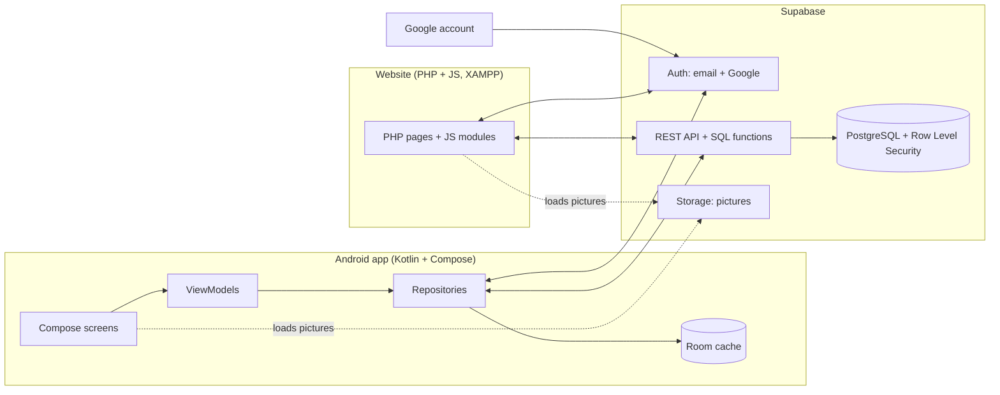
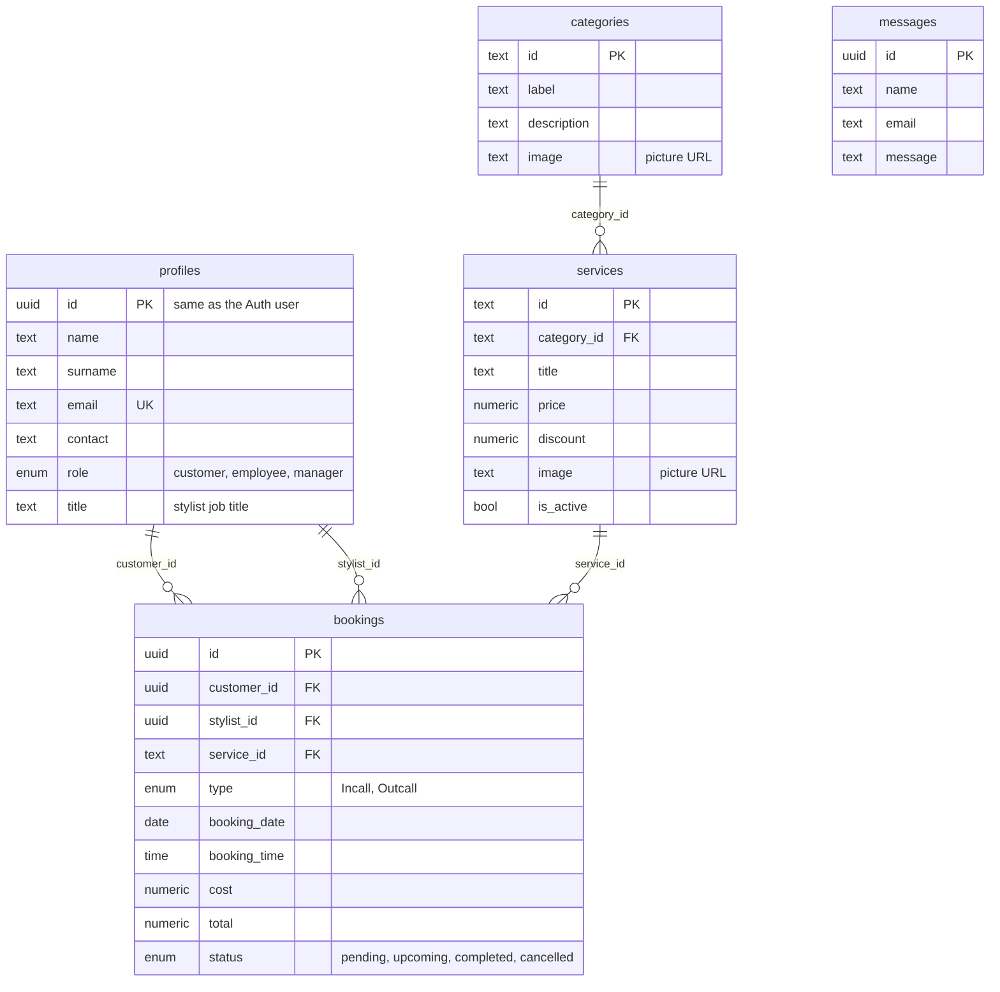

# Mary Hair Salon

A booking system for a hair salon: an **Android app** (Kotlin, Jetpack Compose) and a **website** (PHP + JavaScript) that share **one hosted Supabase backend** (PostgreSQL database, authentication, REST API and file storage).

> **Module:** XISD6329 - Work Integrated Learning 3B, Diploma in IT Software Development, The IIE
> **Team:** Armstrong Tatera, Ambesiwe Gantsho, Luthando Didiza
> **Demo video:** `[add your YouTube / unlisted video link here]`

## Contents

1. [Purpose of the app and website](#1-purpose-of-the-app-and-website)
2. [Screenshots](#2-screenshots)
3. [Features](#3-features)
4. [Architecture and design considerations](#4-architecture-and-design-considerations)
5. [Database design](#5-database-design)
6. [Security](#6-security)
7. [Testing, GitHub and GitHub Actions](#7-testing-github-and-github-actions)
8. [Release notes](#8-release-notes)
9. [Running the project](#9-running-the-project)
10. [Demo accounts](#10-demo-accounts)
11. [Repository layout](#11-repository-layout)

---

## 1. Purpose of the app and website

**The problem.** Salons that take appointments by phone or message end up with double bookings, clients who cannot see which times are free or what a style will cost, and stylists who have no single place to see and manage their day.

**Who it is for.**

| User | What they need |
|---|---|
| **Customer** | Browse styles and prices, pick a stylist and a free time, and track, move or cancel bookings |
| **Stylist (employee)** | See their own bookings, and accept, decline, complete or cancel them |
| **Manager** | See every booking, reassign stylists, promote accounts, and edit categories, services and prices |

**What it does.** Customers book in a few taps. Times that are already taken are crossed out, the price (with any discount) is worked out by the server, and the database itself refuses a second booking for the same stylist at the same time. Stylists and the manager get their own screens on the phone.

**Expected impact.** Fewer clashes and phone calls, clear prices before booking, and one source of truth for the salon's diary.

## 2. Screenshots

All screenshots are from a real Samsung Galaxy A14 (not an emulator). More are in [`android app folder/docs/screenshots`](android%20app%20folder/docs/screenshots).

| Log in (email or Google) | Services with pictures | Book: free times | Booking summary |
|:--:|:--:|:--:|:--:|
|  |  |  |  |

| My Bookings | Stylist schedule | Manager: all bookings | Help system |
|:--:|:--:|:--:|:--:|
|  |  |  |  |

| Input validation | Settings | Manager: reassign | Manager: edit services |
|:--:|:--:|:--:|:--:|
|  |  |  |  |

**Website screenshots:** `[add screenshots of the website: home, services, booking form, My Bookings, Google sign-in]`

## 3. Features

### Android app

* **Register and log in** with email and password, or **Continue with Google** (single sign-on through Android Credential Manager).
* **Services:** 10 categories and 20 services, each with its own picture; search; a "Limited Time" deals section built from discounted services.
* **Booking form:** service, style, stylist, Incall (at the salon) or Outcall (address required), date on a calendar, free time slots (08:00 to 19:00), notes, and a live price summary.
* **Invalid input never crashes the app:** friendly messages for empty fields, bad phone numbers, past dates and missing times.
* **My Bookings:** Pending, Upcoming, Completed and Cancelled filters; reschedule and cancel.
* **Stylist role:** a schedule with Accept and Decline for new requests and Complete or Cancel for upcoming ones.
* **Manager role:** all bookings, reassign stylist, change status, staff and accounts (promote or demote), and add, edit or delete categories and services.
* **Settings:** change name, surname and contact number, turn booking notifications on or off, send a password-reset email, log out.
* **Help system** on every main screen, and an **offline cache** so data still shows with a poor connection.

### Website

* Home, Services, About, Contact, Login, Sign up and Forgot password pages.
* Email sign-up and log-in, plus **Continue with Google**.
* Services and categories come live from the database; "Featured styles", "Deals" and "Meet the team" are filled from Supabase too.
* Booking form with real stylists and greyed-out taken times; price read from the database; **My Bookings** with live status counts, reschedule and cancel.
* Contact form saves to the `messages` table.

## 4. Architecture and design considerations



**Design considerations**

* **One backend for both clients.** The app and the website talk to the same Supabase project, so an account or booking made on one shows up on the other.
* **Supabase is the source of truth; Room is only a cache.** Screens read from Room so they open instantly and work offline; each screen refreshes from Supabase when it opens and after every write.
* **Never trust the client.** Price, double-booking, time slots and "who may do what" are enforced inside the database, so a modified app cannot cheat. The app validates first only to give instant feedback.
* **Pure-Kotlin business rules** (`BookingRules`) with no Android code, so they are easy to unit test.
* **Consistent look.** Dark theme, frosted "glass" cards, burnt-orange accent and serif headings on both the app and the website.
* **Original artwork.** The 30 category and service pictures are drawn from code (no stock photos or real people), so there are no licence or privacy issues. They live in a public Supabase Storage bucket and are cached on the phone.
* **Reproducible setup.** The schema, security rules, API functions and seed data are scripts, so the whole backend can be rebuilt in minutes (we did exactly that when the first Supabase project was lost).

## 5. Database design

Five tables in PostgreSQL, with primary and foreign keys, data types and CHECK constraints. At least **10 rows per table** are seeded (13 users, 10 categories, 20 services, 15 bookings, 10 messages).



SQL files, in order: [`001_schema.sql`](Database/migrations/001_schema.sql), [`002_security.sql`](Database/migrations/002_security.sql), [`003_api.sql`](Database/migrations/003_api.sql), [`004_public_stylists.sql`](Database/migrations/004_public_stylists.sql).

## 6. Security

* **Passwords** are hashed (bcrypt) by Supabase Auth; our tables never contain one.
* **Row Level Security** is on for every table: customers see their own bookings, stylists see theirs, the manager sees all, and nobody can change their own role.
* **Double-booking protection:** a unique index allows one active booking per stylist, date and time.
* **Prices cannot be faked:** `create_booking` reads price and discount from `services`.
* **Keys:** only the public *anon* key is in the app and website. The `service_role` key lives only in a git-ignored `.env`, and a GitHub Actions job scans the repository for committed keys.
* **Signing key:** the release keystore is kept out of git (`keystore.properties` and `*.jks` are ignored).

## 7. Testing, GitHub and GitHub Actions

**Unit tests:** 37 tests, 0 failures (`BookingRulesTest` 10, `MappersTest` 10, `ValidationAndModelsTest` 17). Run them with `./gradlew testDebugUnitTest`.

**GitHub.** All code is in this repository. Work is done on branches and merged by pull request, with `main` kept releasable, and the history shows commits from all three team members. The team also tracks work on an Azure DevOps Kanban board with an Azure Pipelines build.

**GitHub Actions** ([`.github/workflows`](.github/workflows)):

| Workflow | Runs when | What it does |
|---|---|---|
| [**Android CI**](.github/workflows/android-ci.yml) | push and pull request | Runs the unit tests (results table in the run summary) and builds the debug APK, uploading both as artifacts |
| [**Android Lint**](.github/workflows/android-lint.yml) | app or Gradle files change | Runs Android Lint and uploads the report |
| [**Backend checks**](.github/workflows/backend-checks.yml) | `database/` changes | Dry-runs the seed (10+ rows per table), checks the SQL has Row Level Security and the double-booking index, scans for committed keys, and verifies every category and service has a picture |
| [**Release APK**](.github/workflows/release-apk.yml) | a `v*` tag is pushed, or by hand | Runs the tests, builds the APK and publishes a GitHub Release with generated release notes |

See [`android app folder/docs/GITHUB_ACTIONS.md`](android%20app%20folder/docs/GITHUB_ACTIONS.md) for the secrets to add and how to make a release.

## 8. Release notes

### v0.1.0

**Since the prototype.** The prototype was a customer-only app with a local Room (SQLite) database and sample accounts. This version is a full client for a hosted backend, with three user roles and a matching website.

**Innovative features added in this version**

| Feature | What it adds |
|---|---|
| **Google single sign-on** | One-tap sign-in on the phone through Credential Manager and a Google button on the website; the profile is created automatically by a database trigger |
| **Double-booking protection** | A database unique index plus live "taken times" crossed out in the calendar, so two clients can never hold the same stylist and time |
| **Server-side pricing** | Price and discount are calculated by the database, not typed by the app |
| **Stylist and manager roles** | Schedule with accept, decline and complete for stylists; reassign, status, staff and catalogue editing for the manager |
| **Picture library** | 30 original illustrations stored in Supabase Storage and shown on category tiles, service cards, deals and the website |
| **Offline cache** | Room keeps the last data on the phone so screens open instantly and survive a weak connection |
| **Settings and Help** | Edit profile and notifications, password reset email, and an in-app help guide |
| **Automated checks** | 37 unit tests and four GitHub Actions workflows |

**Other changes:** friendlier error messages (for example "You're offline"), input validation on every form, a signed release build (`assembleRelease`), and `public_stylists()` so the website can list the team to logged-out visitors.

**Known gaps:** the website only has customer pages (stylist and manager tools are in the app); the Play Store listing is not published.

## 9. Running the project

### 9.1 Database (Supabase), once

1. Create a project at supabase.com.
2. In the SQL Editor, run `001_schema.sql`, `002_security.sql`, `003_api.sql`, `004_public_stylists.sql` in that order.
3. Authentication, Email: turn **Confirm email** off while testing.
4. Seed the data (needs Node.js):
   ```
   cd "android app folder/database/supabase/seed"
   npm install
   copy .env.example .env      # then paste SUPABASE_URL and SUPABASE_SERVICE_ROLE_KEY
   node upload-images.js       # pictures into Storage
   node seed.js                # users, services, bookings, image URLs
   ```
5. **Google sign-in:** create a *Web* OAuth client and an *Android* OAuth client (package `za.co.maryhairsalon` plus your SHA-1) in Google Cloud Console, then turn Google on in Supabase (Authentication, Providers) with the Web client ID and secret.

### 9.2 Android app

1. Open `android app folder` in Android Studio.
2. Copy `local.properties.example` to `local.properties` and fill in `SUPABASE_URL`, `SUPABASE_ANON_KEY` and `GOOGLE_WEB_CLIENT_ID`.
3. Run the app on a phone, or build with `./gradlew assembleDebug`.
4. **Signed release build:** create a keystore, put its details in `keystore.properties` (see the comment in `app/build.gradle.kts`), then run `./gradlew assembleRelease bundleRelease`. The APK is in `app/build/outputs/apk/release/`, and the `.aab` for the Play Console is in `app/build/outputs/bundle/release/`.

### 9.3 Website (XAMPP)

1. Copy this repository's website files into XAMPP's `htdocs`, for example `htdocs/Mary-Hair-Salon`.
2. In `assets/js/supabase-client.js` set `SUPABASE_URL` and `SUPABASE_ANON_KEY` (public anon key only).
3. Start Apache and open `http://localhost/Mary-Hair-Salon/index.php`.
4. In Supabase, Authentication, URL Configuration: set the Site URL to that address and add `http://localhost/**` as a redirect URL. Add `https://<project-ref>.supabase.co/auth/v1/callback` to the Google Web client's authorised redirect URIs.

## 10. Demo accounts

Test data only. All accounts use the password `MaryDemo#2026`.

| Role | Email |
|---|---|
| Manager | `manager@maryhairsalon.test` |
| Stylists | `lerato@`, `sipho@`, `thandi@`, `zara@` + `maryhairsalon.test` |
| Customer | `ayanda@example.test` |

Stylist and manager screens are in the **Android app**; the website shows customer pages for every account.

## 11. Repository layout

```
/                          website: index.php, services.php, bookings.php, ... components/, assets/
/Database/                 SQL migrations + seed script
/android app folder/       Android app (Kotlin) with its own database/, docs/ and tests
/.github/workflows/        GitHub Actions
```

Useful docs: [`DATA_LAYER.md`](android%20app%20folder/DATA_LAYER.md) (how the app reads and writes data), [`database/supabase/README.md`](android%20app%20folder/database/supabase/README.md) (database setup) and the Task 3 presentation in [`android app folder/docs`](android%20app%20folder/docs).
